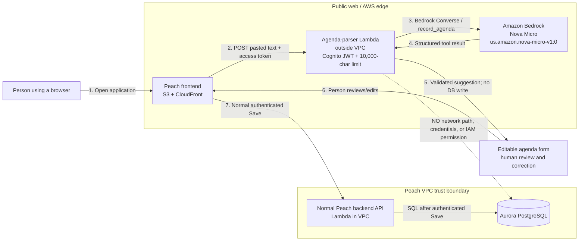

# ADR 0006: LLM-assisted agenda parsing with Amazon Nova

Status: Accepted

## Context

Peach needs to turn pasted, unstructured meeting text into an editable agenda. The lab brief
originally proposed Claude. Claude Opus 5.5 and Claude Sonnet 5 both returned HTTP 403 for this
AWS account and required Anthropic first-use approval. Rather than wait for that external approval,
we selected Amazon Nova Micro, which was available and successfully invoked through Amazon
Bedrock in `us-east-1`.

The model must only suggest data. It must never write to Aurora or bypass the application's
authenticated API.

## Decision

Use the Bedrock Runtime Converse API with the cross-region inference profile
`us.amazon.nova-micro-v1:0`. The parser forces the `record_agenda` tool and validates its input
with Pydantic. It makes one corrective retry after invalid structured output. Prompt version
`agenda-v1` explicitly treats pasted content as untrusted data rather than instructions.

An isolated, container-image Lambda runs outside the database VPC. Its Function URL accepts
authenticated POST requests only, validates the existing Cognito access token, rejects inputs
over 10,000 characters before calling Bedrock, and has no database credentials or permissions.
Its role can invoke only the Nova Micro inference profile and its destination foundation models.

The browser displays the parsed values in the normal meeting form. Suggested fields are marked
until edited. Only after a person reviews and submits the form does the existing authenticated
backend API write a meeting to Aurora. Peach stores the original AI suggestion, model ID, and
prompt version beside the reviewed meeting for traceability.

If Bedrock is unavailable or parsing fails, the UI reports the failure and leaves the normal
agenda form usable. A person can always enter and save an agenda manually through the same API.
AI parsing is an optional assistive path, not a prerequisite for using Peach.

## Container view and trust boundary

The dotted parser-to-Aurora line is explicitly denied: the parser is not attached to the VPC,
has no database configuration or credentials, and its role contains no RDS or database actions.

## Telemetry and cost

Each successful parse emits one JSON log containing the Cognito subject, model, prompt version,
input/output token counts, latency, and estimated USD cost. It never logs pasted text or tokens.
The estimate uses the current Nova Micro rates configured in code. A monthly AWS Budget alerts at
80% actual and 100% forecast of USD 5; the notification address is supplied at deployment time.

Five production evaluations cost between `$0.00004263` and `$0.00005722` each, averaging
approximately `$0.00005` per parse. Latency ranged from 0.797 to 1.106 seconds. See
[the Step 5 evaluation](../evaluations/agenda-v1-step5.md).

## Consequences

- Nova output can be incomplete or wrong, so human review remains mandatory.
- A production prompt-injection test changed an action owner to an email address supplied by the
  injected instruction. Prompt wording reduces risk but cannot establish a security boundary;
  visible human review and the parser's lack of database access are the actual controls.
- The parser URL is public at the network layer but every parse requires a valid Cognito access
  token. CORS is limited to the Peach frontend origin.
- Cross-region inference can execute in the profile's listed US regions. IAM therefore names the
  inference profile and each destination foundation model ARN.
- Pricing is configuration captured at implementation time and must be reviewed when AWS pricing
  changes.
- Deploying a new backend image precedes deploying the AI stack because the parser reuses that
  image. Migration `0004` must run before the frontend can save agendas.
